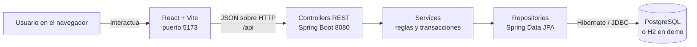

# Butaca

Sistema web para gestion de eventos y venta simulada de entradas. El proyecto implementa un backend REST en Spring Boot y un frontend en React, alineados con el SRS local `srs_proyecto.md`.

Material para la exposicion:

- [Guia de presentacion](docs/guia-presentacion.md): guion, recorrido de demo y preguntas frecuentes.
- [Glosario y explicacion de base de datos](docs/glosario-y-modelo-base-de-datos.md): glosario de tablas, 3FN, concurrencia y preguntas para el profesor.
- [Modelo y diagrama de base de datos](docs/normalizacion-base-datos.md): normalizacion 3FN, claves y relaciones.
- [`butaca.dbml`](butaca.dbml): modelo gráfico editable en dbdiagram.io.

## Estado Del Proyecto

- Backend REST con entidades JPA normalizadas.
- Frontend React conectado a endpoints reales.
- Registro e inicio de sesion con roles.
- Catalogo publico de eventos publicados.
- Compra de entradas con emision de UUID por ticket.
- Trazabilidad de emisión, uso y anulación de entradas.
- Panel de organizador para crear, publicar, cancelar y revisar ventas.
- Panel de cliente para compras y notificaciones.
- Panel administrativo con metricas generales, categorias y ubicaciones.

## Arquitectura



El frontend no accede directamente a la base. Siempre llama a la API; los controladores delegan la regla de negocio a servicios y los repositorios traducen las operaciones Java a SQL.

## Modelo De Datos Normalizado

El modelo vigente usa un diseno relacional en tercera forma normal para el alcance del SRS:

| Tabla | Responsabilidad |
| --- | --- |
| `rol` | Catalogo de permisos: `ADMIN`, `ORGANIZADOR`, `CLIENTE`. |
| `usuario` | Datos de cuenta, credenciales, telefono, estado y rol. |
| `ubicacion` | Lugares fisicos con direccion, capacidad maxima y estado activo. |
| `categoria` | Clasificacion de eventos. |
| `evento` | Datos publicables, precio, cupo total, estado, version, organizador, categoria y ubicacion. |
| `compra` | Cabecera minima: cliente, fecha y estado. |
| `entrada` | Tickets emitidos con UUID unico, estado y precio historico pagado. |
| `historial_estado_entrada` | Cambios de estado de cada ticket. |
| `notificacion` | Mensajes internos del MVP. |

### Evaluacion De Normalizacion

- **1FN:** todos los campos son atomicos; no hay listas serializadas en columnas.
- **2FN:** las tablas usan claves primarias simples y cada atributo depende de su entidad completa.
- **3FN:** datos como rol, categoria y ubicacion se separan en tablas propias para evitar dependencias transitivas.
- **BCNF practica:** las claves candidatas relevantes se protegen con unicidad, por ejemplo email de usuario, nombre de rol y codigo unico de entrada.
- **Control de concurrencia:** `evento.version_evento` usa bloqueo optimista para reducir riesgo de sobreventa.

No se persisten `cupos_disponibles`, `cantidad` ni `total`. Los servicios los
calculan desde las entradas, pero los DTO los siguen entregando al frontend para
mantener una interfaz simple.

Detalle ampliado: `docs/normalizacion-base-datos.md`.

## Requisitos

- Java 17 con `JAVA_HOME` configurado.
- Node.js `>=20.19.0` o `>=22.12.0` (`.nvmrc` fija `22.20.0`).
- pnpm `>=11.3.0` para dependencias del frontend.
- PostgreSQL accesible sólo si se usa el perfil normal; la demo no lo necesita.
- Visual Studio Code como editor recomendado del proyecto.

## Configuracion Rapida

### Demo Para Clase Con Un Solo Comando

El modo demo levanta backend, frontend y una base local H2 en memoria. No requiere PostgreSQL ni credenciales externas.

En Windows PowerShell:

```powershell
powershell -ExecutionPolicy Bypass -File .\scripts\demo.ps1
```

En Git Bash, Linux o macOS:

```bash
./scripts/demo.sh
```

Si es la primera vez que se usa el proyecto en esa maquina, el script puede descargar dependencias Maven y pnpm. Para preparar todo antes de clase, ejecutar una vez:

```bash
./mvnw compile
cd frontend
pnpm install
```

Si Maven tiene problemas de permisos con la cache del usuario, se puede usar una cache local del proyecto:

```bash
MAVEN_REPO_LOCAL=.m2/repository ./scripts/demo.sh
```

URLs:

- Frontend: `http://localhost:5173`
- Backend: `http://localhost:8080`
- API: `http://localhost:8080/api`
- Consola H2: `http://localhost:8080/h2-console`
- JDBC H2: `jdbc:h2:mem:butaca_demo`, usuario `sa`, password vacio.

Credenciales demo:

- `admin@butaca.com` / `admin123`
- `org@butaca.com` / `org123`
- `cliente@butaca.com` / `cliente123`

La base H2 se recrea en cada ejecucion, por eso siempre arranca con datos semilla limpios.

Para cerrar los dos procesos, presionar `Ctrl+C` en la terminal que inicio la demo.

Si el puerto `8080` ya esta ocupado, se puede usar otro para el backend sin editar codigo:

```powershell
powershell -ExecutionPolicy Bypass -File .\scripts\demo.ps1 -BackendPort 8081
```

### Donde Esta La Base De Datos

Hay dos configuraciones y se usa una sola por ejecucion:

| Modo | Ubicacion | Persistencia | Como verla |
| --- | --- | --- | --- |
| Presentacion (`demo`) | Dentro de la memoria del proceso Java | Se reinicia al cerrar el backend | Consola H2 en `http://localhost:8080/h2-console` |
| Desarrollo real | Servidor PostgreSQL indicado por `DB_URL` | Permanente | pgAdmin, DBeaver o `psql` |

Datos de acceso a H2 durante la demo:

- JDBC URL: `jdbc:h2:mem:butaca_demo`
- User Name: `sa`
- Password: dejar vacio
- Driver Class: `org.h2.Driver`

La estructura ejecutable la genera Hibernate desde las entidades JPA de
`src/main/java/com/demo/butaca/model/`. `butaca.dbml` es su representación
didáctica. En demo se usa `create-drop`; para PostgreSQL se recomienda comenzar
con una base vacía porque esta refactorización no migra el modelo anterior.

### Ejecucion Con PostgreSQL

1. Copiar variables de entorno:

```bash
cp .env.example .env
cp frontend/.env.example frontend/.env
```

2. Definir credenciales de base de datos:

```bash
export DB_URL=jdbc:postgresql://localhost:5432/butaca
export DB_USERNAME=tu_usuario
export DB_PASSWORD=tu_password
```

En PowerShell:

```powershell
$env:DB_URL="jdbc:postgresql://localhost:5432/butaca"
$env:DB_USERNAME="tu_usuario"
$env:DB_PASSWORD="tu_password"
```

3. Instalar dependencias frontend:

```bash
cd frontend
pnpm install
```

4. Compilar backend:

```bash
cd ..
./mvnw compile
```

5. Levantar backend:

```bash
./mvnw spring-boot:run
```

6. Levantar frontend:

```bash
cd frontend
pnpm run dev
```

URLs por defecto:

- Backend: `http://localhost:8080`
- API: `http://localhost:8080/api`
- Frontend: `http://localhost:5173`

## Variables De Entorno

Backend:

| Variable | Uso |
| --- | --- |
| `DB_URL` | URL JDBC de PostgreSQL. Fallback: `jdbc:postgresql://localhost:5432/butaca`. |
| `DB_USERNAME` | Usuario PostgreSQL. |
| `DB_PASSWORD` | Password PostgreSQL. |

Frontend:

| Variable | Valor por defecto |
| --- | --- |
| `VITE_API_BASE_URL` | `http://localhost:8080/api` |

## Perfiles Backend

| Perfil | Base de datos | Uso |
| --- | --- | --- |
| default | PostgreSQL remoto/local segun `application.properties` | Desarrollo real e integracion. |
| `demo` | H2 en memoria | Presentacion rapida en clase con `./scripts/demo.sh`. |

## Datos Demo

`DataLoader` crea automaticamente:

- `admin@butaca.com` / `admin123`
- `org@butaca.com` / `org123`
- `cliente@butaca.com` / `cliente123`

Tambien crea roles, categorias, ubicaciones, eventos, compras, entradas, historial
y notificaciones si la base esta vacia.

## Endpoints Principales

### Auth

- `POST /api/auth/register`
- `POST /api/auth/login`

### Eventos

- `GET /api/eventos`
- `GET /api/eventos/{id}`
- `POST /api/eventos`
- `PUT /api/eventos/{id}`
- `PUT /api/eventos/{id}/publicar`
- `PUT /api/eventos/{id}/cancelar`
- `GET /api/eventos/organizador/{id}`
- `GET /api/eventos/{id}/entradas`

### Compras Y Entradas

- `POST /api/compras`
- `GET /api/compras/{id}`
- `GET /api/compras/usuario/{id}`
- `GET /api/compras/organizador/{id}`
- `GET /api/entradas/usuario/{id}`
- `GET /api/entradas/validar/{codigo}`
- `PUT /api/entradas/{id}/usar`

### Administracion

- `GET /api/admin/dashboard`
- `GET /api/admin/stats`
- `GET /api/admin/categorias`
- `POST /api/admin/categorias`
- `GET /api/admin/ubicaciones`
- `POST /api/admin/ubicaciones`
- `GET /api/admin/usuarios`

### Notificaciones

- `GET /api/notificaciones/usuario/{id}`
- `GET /api/notificaciones/evento/{eventoId}`
- `PUT /api/notificaciones/{id}/leida`

## Dependencias Y Alineacion Con El SRS

Las herramientas actuales son adecuadas para el alcance academico:

- **Spring Boot + JPA:** cubre persistencia, reglas de negocio y transacciones.
- **PostgreSQL:** adecuado para integridad referencial, UUID, indices y concurrencia.
- **BCrypt:** suficiente para hash de passwords en el MVP.
- **React + Vite:** adecuado para catalogo, checkout y paneles por rol.
- **React Router:** cubre navegacion por vistas sin agregar complejidad.

No se usa una pasarela de pagos real. El checkout lo indica claramente, no solicita
datos de tarjeta y confirma una compra simulada.

### Alcance De Seguridad Del MVP

Las contrasenas se almacenan con BCrypt y el login valida credenciales reales contra la base. La sesion de interfaz se conserva en `butaca-auth-user`; el proyecto todavia no implementa JWT ni autorizacion de endpoints en el servidor. Esa proteccion es una mejora necesaria antes de un despliegue productivo, pero no impide demostrar los flujos academicos del MVP.

## Problemas Frecuentes

### Maven falla con `JAVA_HOME`

Instalar Java 17 y definir `JAVA_HOME`. En WSL:

```bash
sudo apt-get update
sudo apt-get install openjdk-17-jdk
export JAVA_HOME=/usr/lib/jvm/java-17-openjdk-amd64
```

### Vite falla por `@rolldown/binding-*`

Ocurre cuando `node_modules` fue instalado en otro sistema operativo o faltan dependencias opcionales. Ejecutar dentro de WSL:

```bash
cd frontend
pnpm install
pnpm run build
```

## Estructura

```text
.vscode
├── extensions.json
└── settings.json

src/main/java/com/demo/butaca
├── config
├── controller
├── dto
├── model
├── repository
└── service

frontend/src
├── components
├── data
├── pages
├── services
├── styles
└── utils
```

## Higiene Del Repositorio

El repositorio mantiene solamente codigo fuente, configuracion necesaria y documentacion vigente. Se excluyen artefactos generados y metadatos de otros editores:

- `frontend/dist/`
- `target/`
- `node_modules/`
- `package-lock.json`
- `yarn.lock`
- `.idea/`
- `.opencode/`
- `.agents/`
- `.codex/`

La configuracion de editor versionable queda limitada a `.vscode/settings.json` y `.vscode/extensions.json`.

## Verificacion

En Windows:

```powershell
.\mvnw.cmd compile
.\mvnw.cmd test
cd frontend
corepack pnpm run build
```

En Git Bash, Linux o macOS:

```bash
./mvnw compile
./mvnw test
cd frontend
pnpm run build
```

El frontend debe compilar sin errores. `pnpm run build` genera `frontend/dist/` localmente, pero esa carpeta no se versiona. El backend requiere Java 17 disponible en el entorno.
