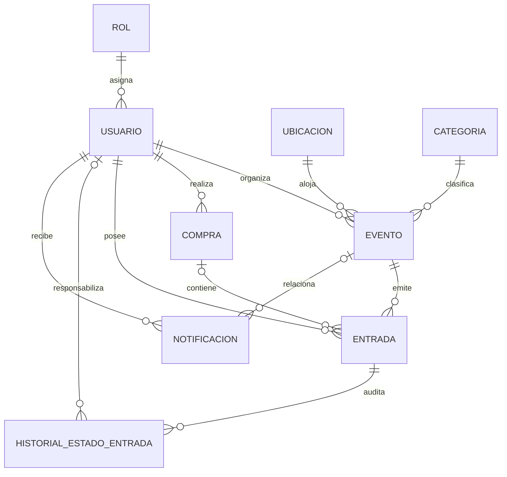

# Glosario y Explicación del Modelo de Base de Datos - Butaca

Este documento proporciona el **glosario conceptual**, la **justificación de diseño relacional (3FN)** y las **respuestas técnicas estructuradas** para defender y explicar el modelo de datos del proyecto ante el docente o evaluador.

El esquema canónico formal se encuentra definido en [`butaca.dbml`](../butaca.dbml).

---

## 1. Diagrama Entidad-Relación y Estructura Global



---

## 2. Glosario de Entidades (9 Tablas del Sistema)

### 1. `rol` (Catálogo de perfiles)
* **Propósito**: Define los niveles de acceso del sistema (`ADMIN`, `ORGANIZADOR`, `CLIENTE`).
* **Columnas principales**: `id_rol` (PK), `nombre_rol` (UNIQUE, CHECK).
* **Justificación técnica**: Desacoplar los roles evita escribir cadenas de texto duplicadas en la tabla de usuarios y garantiza integridad referencial en los permisos.

### 2. `usuario` (Cuentas y credenciales)
* **Propósito**: Almacena las cuentas de acceso, datos personales y estado operativo.
* **Columnas principales**: `id_usuario` (PK), `id_rol` (FK), `nombre_usuario`, `apellido_usuario`, `email_usuario` (UNIQUE), `password_hash_usuario`, `estado_usuario` (`ACTIVO`, `INACTIVO`, `SUSPENDIDO`).
* **Justificación técnica**: La contraseña se guarda hasheada con BCrypt y nunca es expuesta en los DTOs de respuesta de la API REST.

### 3. `ubicacion` (Recintos físicos)
* **Propósito**: Representa los lugares físicos donde se llevan a cabo los espectáculos (teatros, estadios, salas culturales).
* **Columnas principales**: `id_ubicacion` (PK), `nombre_ubicacion`, `direccion_ubicacion`, `capacidad_maxima_ubicacion`, `activa_ubicacion`.
* **Justificación técnica**: Evita duplicar nombre, dirección y aforo en cada evento. Si un teatro alberga 10 eventos, sus datos físicos se registran una sola vez. Las ubicaciones con historia se desactivan en lugar de eliminarse para preservar la integridad referencial.

### 4. `categoria` (Clasificación de eventos)
* **Propósito**: Catálogo temático para organizar la cartelera (Conciertos, Teatro, Deportes, Festivales).
* **Columnas principales**: `id_categoria` (PK), `nombre_categoria` (UNIQUE), `descripcion_categoria`.

### 5. `evento` (Publicación del espectáculo)
* **Propósito**: Ficha pública de un espectáculo creada por un organizador.
* **Columnas principales**: `id_evento` (PK), `id_organizador` (FK), `id_ubicacion` (FK), `id_categoria` (FK), `titulo_evento`, `descripcion_evento`, `fecha_evento`, `hora_evento`, `precio_actual_entrada`, `cupo_total_evento`, `estado_evento` (`BORRADOR`, `PUBLICADO`, `CANCELADO`), `version_evento` (Control de concurrencia).
* **Regla de integridad**: `cupo_total_evento` no puede superar la `capacidad_maxima_ubicacion` del recinto asignado.
* **Sin datos calculados**: No almacena `cupos_disponibles` como columna física persistida.

### 6. `compra` (Cabecera de transacción comercial)
* **Propósito**: Registra la operación comercial mínima entre un cliente y el sistema.
* **Columnas principales**: `id_compra` (PK), `id_cliente` (FK), `fecha_compra`, `estado_compra` (`PENDIENTE`, `CONFIRMADA`, `CANCELADA`).
* **Sin redundancias**: No almacena `id_evento`, `cantidad` ni `total`. Esos datos derivan de las entradas emitidas asociadas a la compra.

### 7. `entrada` (Ticket individual emitido)
* **Propósito**: Representa cada pase digital individual generado tras una compra o cortesía.
* **Columnas principales**: `id_entrada` (PK), `codigo_unico_entrada` (UUID único para validación/QR), `id_evento` (FK), `id_cliente` (FK), `id_compra` (FK nullable), `precio_pagado_entrada`, `estado_entrada` (`CONFIRMADA`, `USADA`, `ANULADA`), `fecha_validacion_entrada`, `version_entrada`.
* **Hecho histórico inmutable**: `precio_pagado_entrada` congela el valor pagado al momento de la compra para garantizar la exactitud contable aun si el evento cambia su precio posteriormente.

### 8. `historial_estado_entrada` (Auditoría y trazabilidad)
* **Propósito**: Registro cronológico de los cambios de estado de cada ticket (emisión, ingreso en puerta, anulación por cancelación de evento).
* **Columnas principales**: `id_historial_entrada` (PK), `id_entrada` (FK), `estado_anterior_entrada`, `estado_nuevo_entrada`, `id_usuario_responsable` (FK nullable), `motivo_cambio_entrada`, `fecha_cambio_entrada`.

### 9. `notificacion` (Mensajería interna del sistema)
* **Propósito**: Mensajes operativos enviados a los usuarios ante eventos relevantes (confirmación de compra, cancelación o reprogramación).
* **Columnas principales**: `id_notificacion` (PK), `id_usuario_destinatario` (FK), `id_evento_relacionado` (FK nullable), `mensaje_notificacion`, `tipo_notificacion`, `leida_notificacion`.

---

## 3. Glosario de Conceptos Técnicos y Arquitectura

* **Clave Primaria (Primary Key - PK)**: Identificador único, no nulo e inmutable para cada fila de una tabla (ej: `id_evento`).
* **Clave Foránea (Foreign Key - FK)**: Restricción que vincula una columna con la PK de otra tabla, asegurando integridad referencial (ej: `evento.id_ubicacion -> ubicacion.id_ubicacion`).
* **UUID (Universally Unique Identifier)**: Identificador alfanumérico globalmente único de 128 bits utilizado en `codigo_unico_entrada`. Permite generar el código QR de acceso sin exponer IDs secuenciales predecibles.
* **Atomicidad de Datos**: Principio donde cada columna almacena un único valor indivisible y cada entrada física corresponde a una fila independiente en la base de datos.
* **Bloqueo Optimista (`@Version`)**: Mecanismo de control de concurrencia provisto por JPA/Hibernate. Al actualizar un registro, se verifica que el número de versión no haya cambiado. Si dos transacciones intentan comprar el último cupo simultáneamente, una confirma y la otra aborta con `OptimisticLockException`, evitando la sobreventa (*overbooking*).
* **Transaccionalidad ACID (`@Transactional`)**: Garantiza que la inserción de la compra, la generación de las $N$ entradas y los registros de auditoría en el historial se ejecuten como una única unidad atómica. Si ocurre un fallo, todo se revierte (*rollback*).

---

## 4. Justificación de Normalización (Tercera Forma Normal - 3FN)

### Primera Forma Normal (1FN)
1. **Valores atómicos**: No existen campos compuestos ni listas separadas por comas.
2. **Sin grupos repetitivos**: Una compra de 4 entradas no almacena una lista dentro de `compra`; genera exactamente 4 filas individuales en la tabla `entrada`.

### Segunda Forma Normal (2FN)
1. El esquema cumple 1FN.
2. Todas las tablas poseen una Clave Primaria simple (`id_...`).
3. Todos los atributos no clave dependen funcional y completamente de la totalidad de la clave primaria.

### Tercera Forma Normal (3FN)
1. El esquema cumple 2FN.
2. **Sin dependencias transitivas ni columnas derivadas**:
   * Los datos del recinto (`direccion`, `capacidad_maxima`) residen en `ubicacion` y no en `evento`.
   * El nombre del rol reside en `rol` y no en `usuario`.
   * **Valores calculados no persistidos**:
     * El **cupo disponible** no se guarda en `evento`. Se calcula en tiempo de ejecución:
       $$\text{cupo\_disponible} = \text{cupo\_total\_evento} - \text{count(entradas CONFIRMADA o USADA)}$$
     * La **cantidad de entradas** y el **total abonado** no se guardan en `compra`. Se obtienen contando sus entradas asociadas y sumando sus `precio_pagado_entrada`.

---

## 5. Respuestas Rápidas para la Exposición en Clase

### Pregunta 1: ¿Por qué guardan `precio_pagado_entrada` en la entrada si ya existe `precio_actual_entrada` en el evento?
> **Respuesta**:
> "Porque responden a naturalezas distintas:
> * `evento.precio_actual_entrada` es el **precio de lista vigente** para futuras ventas.
> * `entrada.precio_pagado_entrada` es un **hecho histórico inmutable**. Congela el precio exacto abonado por el cliente al momento de la transacción. Si el organizador aumenta el valor del espectáculo a futuro, las compras pasadas mantienen intacto su balance financiero y legal."

---

### Pregunta 2: ¿Cómo evitan que se vendan más entradas de las disponibles ante usuarios simultáneos?
> **Respuesta**:
> "Aplicamos dos niveles de control:
> 1. **Regla de negocio en Service**: Se valida que la suma de entradas vigentes más la cantidad solicitada no exceda el cupo total, y que este cupo no supere la capacidad física de la ubicación.
> 2. **Concurrencia con Bloqueo Optimista**: La entidad `Evento` cuenta con `@Version int version_evento`. En el flujo de compra, Spring Boot ejecuta la operación dentro de una transacción `@Transactional` con bloqueo forzado sobre el evento. Si dos clientes intentan comprar el último cupo en el mismo instante, la primera transacción incrementa la versión y la segunda es rechazada con rollback automático."

---

### Pregunta 3: ¿Por qué `compra` no tiene `id_evento`, `cantidad` ni `total`?
> **Respuesta**:
> "Para cumplir estrictamente con la **Tercera Forma Normal (3FN)** y evitar duplicidad de fuentes de verdad:
> * La relación con el evento se establece a través de cada `entrada`.
> * La cantidad es el recuento de entradas vinculadas a esa compra (`COUNT(entrada)`).
> * El total es la sumatoria de los precios pagados (`SUM(precio_pagado_entrada)`).
> Mantener esas columnas en `compra` generaría inconsistencias si una entrada se anula o cancela."

---

### Pregunta 4: ¿Cómo funciona el control de acceso en puerta?
> **Respuesta**:
> "Cada entrada posee un código UUID único generado automáticamente (`codigo_unico_entrada`), el cual se codifica en un código QR. Al escanearlo en el ingreso:
> 1. Se valida que el estado sea `CONFIRMADA`.
> 2. Pasa a estado `USADA` y se registra la fecha y hora exacta en `fecha_validacion_entrada`.
> 3. Se inserta una fila de auditoría en `historial_estado_entrada`.
> 4. La columna `version_entrada` impide mediante concurrencia optimista que un mismo código QR sea procesado simultáneamente en dos molinetes diferentes."

---

## 6. Consultas SQL de Demostración para la Consola H2

Durante la presentación, se puede abrir la consola en `http://localhost:8080/h2-console` (JDBC URL: `jdbc:h2:mem:butaca_demo`, usuario: `sa`, clave: vacía) y ejecutar las siguientes consultas:

```sql
-- 1. Ver eventos, cupos totales y versiones de concurrencia
SELECT id_evento, titulo_evento, estado_evento, cupo_total_evento, version_evento
FROM evento;

-- 2. Ver cabeceras mínimas de compras registradas
SELECT id_compra, id_cliente, fecha_compra, estado_compra
FROM compra
ORDER BY fecha_compra DESC;

-- 3. Ver tickets individuales con UUID y precio histórico congelado
SELECT id_entrada, codigo_unico_entrada, id_evento, estado_entrada, precio_pagado_entrada, id_compra
FROM entrada
ORDER BY id_entrada DESC;

-- 4. Ver trazabilidad y auditoría de cambios de estado de tickets
SELECT id_historial_entrada, id_entrada, estado_anterior_entrada, estado_nuevo_entrada, motivo_cambio_entrada, fecha_cambio_entrada
FROM historial_estado_entrada
ORDER BY fecha_cambio_entrada DESC;
```
