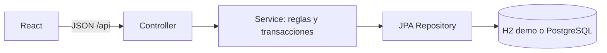

# Guía De Presentación - Butaca

Esta guía propone una exposición simple de 6 a 8 minutos. La demo usa H2 en
memoria, por lo que no necesita instalar PostgreSQL.

## Antes De La Clase

```powershell
.\mvnw.cmd test
Set-Location frontend
corepack pnpm install --frozen-lockfile
corepack pnpm run build
Set-Location ..
```

## Iniciar Todo

En Windows:

```powershell
powershell -ExecutionPolicy Bypass -File .\scripts\demo.ps1
```

En Git Bash, Linux o macOS:

```bash
./scripts/demo.sh
```

Abrir `http://localhost:5173`. Para cerrar backend y frontend, presionar
`Ctrl+C` en la terminal.

| Rol | Email | Password |
| --- | --- | --- |
| Administrador | `admin@butaca.com` | `admin123` |
| Organizador | `org@butaca.com` | `org123` |
| Cliente | `cliente@butaca.com` | `cliente123` |

## Guion Recomendado

### 1. Qué Resuelve

> Butaca permite publicar eventos, controlar la capacidad de los lugares, realizar
> compras simuladas y emitir un UUID distinto por cada entrada.

Existen tres roles: administrador, organizador y cliente.

### 2. Arquitectura



El frontend nunca accede directamente a la base. Los controladores reciben las
peticiones y las reglas viven en los servicios.

### 3. Recorrido Del Cliente

1. Iniciar sesión como `cliente@butaca.com`.
2. Mostrar que el catálogo contiene únicamente eventos publicados con cupo.
3. Elegir un evento y una cantidad.
4. Confirmar la compra simulada. No se solicitan datos de tarjeta.
5. Mostrar los UUID individuales en la confirmación y el panel del cliente.

Explicación técnica:

- `Compra` sólo persiste cliente, fecha y estado.
- Por cada unidad se crea una fila en `Entrada`.
- Cantidad y total se calculan desde esas entradas.
- El precio pagado queda congelado dentro del ticket.

### 4. Recorrido Del Organizador

1. Iniciar sesión como `org@butaca.com`.
2. Crear un evento seleccionando una ubicación y una categoría existentes.
3. Guardarlo como borrador y luego publicarlo.
4. Mostrar ventas, entradas emitidas y cupos calculados.
5. Cancelar un evento de prueba: sus entradas confirmadas pasan a anuladas y se
   generan notificaciones.

### 5. Base De Datos Y Trazabilidad

Abrir `http://localhost:8080/h2-console`:

- JDBC URL: `jdbc:h2:mem:butaca_demo`
- User Name: `sa`
- Password: vacío

Consultas para la exposición:

```sql
SELECT id_evento, titulo_evento, estado_evento,
       cupo_total_evento, version_evento
FROM evento;

SELECT id_compra, id_cliente, fecha_compra, estado_compra
FROM compra
ORDER BY fecha_compra DESC;

SELECT id_entrada, codigo_unico_entrada, estado_entrada,
       precio_pagado_entrada, id_compra
FROM entrada
ORDER BY id_entrada DESC;

SELECT id_entrada, estado_anterior_entrada, estado_nuevo_entrada,
       motivo_cambio_entrada, fecha_cambio_entrada
FROM historial_estado_entrada
ORDER BY fecha_cambio_entrada DESC;
```

El diagrama editable es [`butaca.dbml`](../butaca.dbml) y la explicación de
normalización está en [`normalizacion-base-datos.md`](normalizacion-base-datos.md).

## Respuestas Cortas Para El Profesor

**¿Dónde está la base?**  
En la demo vive en memoria dentro de Spring Boot. Se recrea al iniciar. En el
perfil normal se usa PostgreSQL.

**¿Cómo evitan la sobreventa?**  
Se cuentan las entradas vigentes dentro de una transacción y se bloquea
optimistamente el evento usando `@Version`. Una operación concurrente pierde y
hace rollback.

**¿Por qué no guardan cupos disponibles?**  
Porque se pueden calcular desde el cupo total y los tickets vigentes. Guardarlos
también produciría dos fuentes de verdad.

**¿Por qué no guardan cantidad y total en compra?**  
La cantidad es el número de entradas y el total es la suma de sus precios
históricos. La API los calcula para que el frontend los muestre.

**¿Para qué sirve historial_estado_entrada?**  
Permite saber cuándo un ticket fue emitido, usado o anulado y evita perder
trazabilidad al cambiar el estado actual.

**¿Es una pasarela real?**  
No. El SRS define una compra simulada para el MVP académico; por eso no se capturan
datos bancarios.

## Plan B

- Si faltan dependencias frontend: ejecutar `corepack pnpm install` en
  `frontend/`.
- Si el puerto 8080 está ocupado:
  `powershell -ExecutionPolicy Bypass -File .\scripts\demo.ps1 -BackendPort 8081`.
- Si la consola H2 no conecta, comprobar que el backend siga ejecutándose y que la
  URL sea exactamente `jdbc:h2:mem:butaca_demo`.
