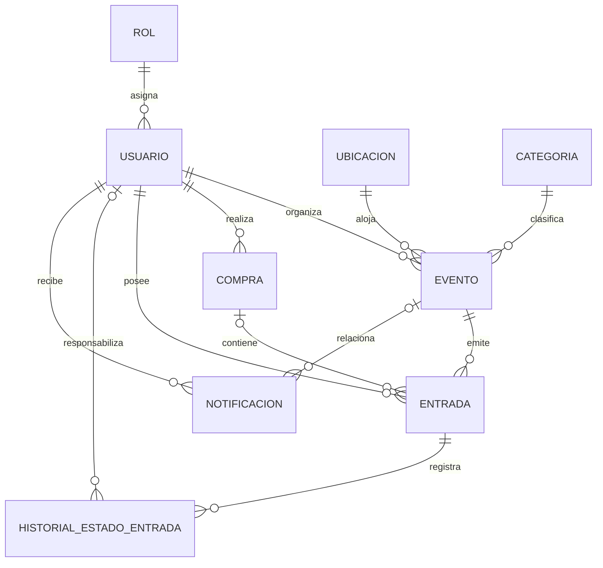

# Modelo De Base De Datos - Butaca

El modelo vigente es intencionalmente pequeño: contiene las ocho entidades del
MVP y una tabla de historial para la trazabilidad de tickets. El archivo gráfico
editable es [`butaca.dbml`](../butaca.dbml).

## Vista General



| Tabla | Función |
| --- | --- |
| `rol` | Catálogo `ADMIN`, `ORGANIZADOR`, `CLIENTE`. |
| `usuario` | Cuenta, credenciales, estado y rol. |
| `ubicacion` | Lugar físico, dirección, capacidad y estado activo. |
| `categoria` | Clasificación de los eventos. |
| `evento` | Publicación, fecha, precio, cupo total y relaciones. |
| `compra` | Cabecera mínima de una operación simulada. |
| `entrada` | Ticket individual con UUID y precio histórico. |
| `historial_estado_entrada` | Emisión, uso o anulación del ticket. |
| `notificacion` | Mensajes internos para los usuarios. |

Los campos `created_at` y `updated_at` son auditoría técnica común de las
entidades JPA. No participan de las relaciones del dominio.

## Cómo Funciona

1. Un organizador crea un evento y selecciona una categoría y una ubicación.
2. El evento se publica si su cupo no supera la capacidad del lugar.
3. El cliente solicita una cantidad de entradas.
4. El servicio cuenta las entradas `CONFIRMADA` y `USADA` del evento.
5. Si hay lugar, crea una compra y un ticket UUID por cada unidad.
6. Cada ticket conserva `precio_pagado_entrada`.
7. Al usar o anular el ticket se actualiza su estado y se agrega una fila al
   historial dentro de la misma transacción.

## Normalización

### Primera Forma Normal

- Cada columna guarda un valor simple.
- No existen listas de tickets dentro de una compra.
- Una compra de tres unidades genera tres filas en `entrada`.

### Segunda Forma Normal

Todas las tablas tienen una PK simple. Sus atributos describen únicamente la
entidad identificada por esa PK.

### Tercera Forma Normal

- El rol se guarda una vez en `rol`.
- La categoría se guarda una vez en `categoria`.
- La dirección y capacidad se guardan en `ubicacion`, no en `evento`.
- `compra` no repite evento, cantidad ni total.
- `evento` no guarda un contador de cupos disponibles.

La cantidad de una compra se obtiene contando sus entradas y su total sumando
`precio_pagado_entrada`. El cupo disponible se calcula así:

```text
cupo disponible =
    cupo_total_evento
    - entradas CONFIRMADA
    - entradas USADA
```

`precio_pagado_entrada` no es una duplicación accidental: representa lo abonado
en el momento de la compra y no cambia si luego se modifica el precio del evento.

## Integridad Y Concurrencia

- Las PK identifican filas y las FK conectan las entidades.
- Email, nombre de rol, nombre de categoría y UUID de entrada son únicos.
- Una ubicación se desactiva si tiene historia; no se elimina.
- El servicio comprueba que el cupo del evento no supere la capacidad del lugar.
- `Evento.version` usa `@Version`.
- Una compra obtiene el evento con bloqueo optimista forzado. Si dos operaciones
  compiten por el último cupo, una falla y toda su transacción se revierte.
- `Entrada.versionEntrada` impide dos usos simultáneos del mismo ticket.

## Base De Datos De La Demo

En el perfil `demo`, H2 mantiene la base dentro de la memoria del proceso Java:

```text
jdbc:h2:mem:butaca_demo
usuario: sa
password: vacío
```

Se puede abrir en `http://localhost:8080/h2-console`. Al detener el backend se
elimina y `DataLoader` vuelve a crear los datos en el próximo inicio.

PostgreSQL se usa con el perfil normal mediante `DB_URL`, `DB_USERNAME` y
`DB_PASSWORD`. Para esta versión se recomienda una base vacía.
